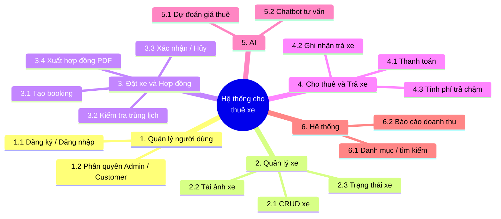

# Tài liệu quyết định kiến trúc & phân rã chức năng

> Đồ án: Hệ thống Cho thuê Xe Thông minh — Tối ưu Giá thuê & Tư vấn Đặt xe bằng AI
> Người viết: Nguyễn Vũ Dũng (nhóm trưởng) · Phiên bản: 1.1 · Cập nhật: 09/2026
> Mọi thay đổi kiến trúc phải qua Pull Request + ADR mới.

## Đối Chiếu Implementation Ngày 26/10/2026

Các ADR bên dưới giữ bối cảnh/quyết định ban đầu; phần phân rã chức năng là phạm vi sản phẩm dự kiến, không xác nhận chức năng đã có. Contract thực tế xem [api-contract.md](api-contract.md), bản đồ code xem [architecture.md](architecture.md), hiện trạng xem [README](../README.md).

Các đính chính theo code local (gồm thay đổi chưa commit):

- Rule giá và orchestration booking nằm trong **Application** (`PricingCalculator`, `BookingService`); query overlap/khóa dòng nằm ở Infrastructure. Không phải toàn bộ rule đều ở Domain như lý do ban đầu của ADR-001.
- Năng phụ trách `ai-service/` Python; .NET AI client đã có ở Infrastructure. ML và Gemini chưa tích hợp; FastAPI vẫn là stub.
- Timeout là 2 giây **mỗi lần gọi**, retry 2 lần và backoff 200/400 ms; không đảm bảo deadline tổng 2 giây.
- Frontend hiện là JavaScript/JSX, không phải TypeScript. Compose gồm năm dịch vụ chạy lâu dài và job `createbuckets`.
- Đăng ký dùng tên/email/điện thoại/mật khẩu, không yêu cầu CCCD. Chỉ email/điện thoại/biển số có unique index; `IdentityNumber` chưa có unique index.
- Các enum hiện bắt đầu từ 1; booking chưa có `Expired`, chưa có tự hết hạn, thu cọc để confirm hay hợp đồng PDF. Confirm hiện do Admin/Staff chuyển `ChoXacNhan` → `DaXacNhan`.
- Booking 1-N Payment đã có model/migration; API thanh toán và nhận/trả xe chưa có. `PaymentStatus` thực tế là `ChuaThanhToan`, `DaCoc`, `DaThanhToan`, `DaHoanTien`.
- Chatbot chưa có ngữ cảnh xe/booking, chưa có proxy .NET và không có chức năng tạo booking từ hội thoại.
- Ngày 26/10/2026 bỏ hai hướng dẫn Jira cũ (backlog chia Epic theo tuần và guide dùng key CRA) vì khác backlog chính dùng CRAI. Bỏ DDL `erd.sql` sai schema; EF migrations là nguồn thực thi, `erd.dbml` được đối chiếu lại với model/snapshot.

---

# PHẦN A — TẠI SAO CHỌN KIẾN TRÚC NÀY

Ánh xạ với khung 3 cột kiến trúc phần mềm:

| Cột | Lựa chọn của đồ án | Không chọn |
|---|---|---|
| 1. Tổ chức mã nguồn | **1.2 Clean / Onion / Hexagonal** | 1.1 Layered N-Tier, 1.3 Vertical Slice |
| 2. Kiến trúc hệ thống | **2.4 Client-Server**, backend bên trong là **2.2 Modular Monolith** | 2.1 Monolith thuần, 2.3 Microservices |
| 3. Giao tiếp / tích hợp | **3.1 Request-Response (HTTP sync)** | 3.2 Event-Driven, 3.3 Queue, 3.4 Pub/Sub |

Nhãn ngắn khi thuyết trình: **Clean Architecture, Modular Monolith**.

---

## ADR-001: Clean Architecture kết hợp Modular Monolith cho backend .NET

**Quyết định:** Solution chia 5 project theo Clean Architecture (Domain / Application / Infrastructure / API / Tests). Bên trong Domain và Application, code được tổ chức theo **module nghiệp vụ** (Cars, Bookings, Customers) — đây là Modular Monolith: một khối deploy duy nhất nhưng chia module rõ.

**Tại sao chọn:**

1. **Tách nghiệp vụ khỏi công nghệ.** Rule cốt lõi (quy tắc giá, kiểm tra trùng lịch thuê, tính phí trả chậm) nằm trong Domain, không dính SQL Server hay HTTP. Đổi database hoặc thêm endpoint không phải sửa nghiệp vụ.
2. **Đúng yêu cầu môn học.** Giám khảo cần thấy code tổ chức chuẩn, không "mì ăn liền" (controller gọi thẳng DbContext).
3. **5 người code song song không giẫm nhau.** Tuấn làm Application/Domain, Năng chỉ chạm API client sang AI service, Tiến lo Docker — mỗi người một tầng, ít conflict khi merge.
4. **Test được.** `CarRental.Tests` kiểm tra rule nghiệp vụ trực tiếp, không cần khởi động web server hay database.
5. **Modular Monolith đủ cho quy mô đồ án.** Vẫn là một ứng dụng .NET duy nhất khi deploy (một image Docker, một process :5001), nhưng folder chia theo Cars / Bookings / Customers nên dễ phân công và dễ mở rộng sau này mà không phải tách microservice.

**Cấu trúc folder (quy ước, không đổi kiến trúc tổng thể):**

```
src/CarRental.Domain/
├── Modules/Cars/          # Car, CarImage
├── Modules/Bookings/      # Booking, Payment, ReturnRecord
├── Modules/Customers/     # Customer
└── Common/                # BaseEntity, Enums

src/CarRental.Application/
├── Modules/Cars/
├── Modules/Bookings/
└── Modules/Customers/
```

Quy tắc phụ thuộc: Domain không tham chiếu gì. Application chỉ tham chiếu Domain. Infrastructure tham chiếu Application. API là composition root.

**Phương án loại:**

- *Layered N-Tier (1.1):* vẫn tách được Presentation / Business / Data nhưng không cưỡng chế được quy tắc — một dòng `using Microsoft.EntityFrameworkCore` lạc chỗ trong Domain là đổ. Clean Arch biến quy tắc thành ràng buộc compile-time.
- *Vertical Slice (1.3):* hợp DDD theo feature, thừa với 5 người / 10 tuần.
- *Microservices cho toàn bộ (2.3):* mỗi service một DB riêng, cần API Gateway, giám sát, mạng nội bộ — quá thừa. Chỉ AI Service là tách thật (ADR-002).

---

## ADR-002: Tách AI Service thành process riêng (FastAPI), không nhúng vào .NET

**Quyết định:** .NET API :5001 (Modular Monolith) và AI Service :5002 (FastAPI) chạy độc lập, giao tiếp qua HTTP. AI không nằm trong monolith.

**Tại sao chọn:**

1. **Hệ sinh thái ML chỉ có ở Python.** XGBoost, scikit-learn RandomForest, pandas, Gemini SDK — hệ thư viện chuẩn ngành đều là Python. Training trong .NET (ML.NET) mất thời gian mà không có công cụ phân tích dữ liệu tương đương.
2. **Năng (phụ trách AI) code Python độc lập**, không cần dựng .NET; Tuấn code .NET không cần cài Python. Ranh giới là 2 endpoint đã contract hóa.
3. **Lỗi AI không sập hệ thống.** AI service chết thì .NET vẫn chạy, tự fallback giá niêm yết (ADR-003).
4. **Scale riêng phần AI** nếu inference nặng — đây là điểm khác biệt khi phản biện, không phải điểm yếu.

**Phương án loại:** nhúng model vào .NET bằng ML.NET — bị loại vì giới hạn thư viện ML và tách khỏi dòng chảy MLOps thực tế.

---

## ADR-003: .NET ↔ AI giao tiếp HTTP đồng bộ, KHÔNG dùng message queue

**Quyết định:** .NET gọi thẳng FastAPI qua HTTP, timeout 2 giây, retry 2 lần, quá thì fallback giá niêm yết + flag `isFallback: true`. Không RabbitMQ/Kafka, không MassTransit/Wolverine.

**Tại sao chọn:**

1. **Bản chất nghiệp vụ là đồng bộ.** Khách bấm "Xem giá đề xuất" thì phải thấy giá ngay trong 1 lần chờ. Queue chỉ có nghĩa khi chấp nhận "gửi lệnh, nhận kết quả sau" — bài toán này không có khâu đó.
2. **Độ trễ yêu cầu thấp:** AI chỉ cần suy đoán giá, không cần hàng phút.
3. **Không thêm hạ tầng phải vận hành.** RabbitMQ = thêm container broker, thêm cấu hình, thêm lỗi để giải quyết — trong 10 tuần với 5 sinh viên, đó là rủi ro lớn hơn lợi ích.
4. **Fallback lo được phần "AI chết":** timeout 2s bắt buộc, response luôn có giá để UI hiển thị.

**Phương án loại:**

- *MassTransit / Wolverine + RabbitMQ (3.2, 3.3, 3.4):* thiết kế cho bất đồng bộ/pub-sub — không khớp bài toán; over-engineering, thầy có thể hỏi "queue giải quyết vấn đề gì ở đây?".
- *gRPC:* nhanh hơn về lý thuyết nhưng thêm bước dựng protobuf, không đáng cho 2 endpoint JSON nhỏ.
- *MediatR:* không phải lựa chọn hạ tầng, chỉ là quy ước code trong Application layer → không bắt buộc.

---

## ADR-004: React + Vite cho frontend; SQL Server cho database

**Quyết định:** Frontend là React SPA :3000 gọi API :5001 bằng JWT. Database dùng SQL Server. Đây là **Client-Server (2.4)** ở tầm hệ thống — không phải Monolith thuần (2.1).

**Tại sao không ghi 2.1 Monolith:**

Monolith (2.1) nghĩa là UI + business + data gom trong **một process deploy duy nhất**. Đồ án có React chạy riêng :3000, .NET API riêng :5001, FastAPI riêng :5002, SQL Server riêng :1433 — 4 process. Đó đúng định nghĩa Client-Server. Ghi 2.1 sẽ bị hỏi: React chạy ở đâu trong monolith? AI Python nhúng vào .NET thế nào?

**Tại sao chọn React + SQL Server:**

React thống nhất TypeScript với team, Vite khởi động nhanh, SPA tách rõ frontend/backend đúng tinh thần DevOps (2 image riêng). SQL Server đồng bộ hệ Microsoft của đề tài, DBML mô hình hóa trước rồi sinh migration.

---

## ADR-005: Docker Compose + GitHub Actions

**Quyết định:** Toàn bộ 4 service (FE, API, AI, SQL Server) dựng bằng 1 file `docker-compose.yml`. CI build + test mỗi Pull Request. Branch `main` và `develop` bắt buộc PR + 1 approval.

**Tại sao:** Triệt tiêu lỗi "máy em chạy được mà". CI bắt lỗi sớm, mỗi PR xanh mới được merge.

---

## ADR-006: MinIO cho lưu trữ ảnh xe

**Quyết định:** Ảnh xe được lưu trong MinIO, tương thích S3, với bucket `car-rental`; không lưu ảnh upload vào `wwwroot`. Chỉ chấp nhận file WebP tối đa 5 MB, kiểm tra cả phần mở rộng, MIME type và magic bytes trước khi lưu. Tên object được sinh bằng GUID để không dùng trực tiếp tên file từ người dùng.

**Tại sao:** MinIO phù hợp môi trường Docker và có thể thay thế bằng S3-compatible storage khi triển khai. Kiểm tra nội dung file thay vì chỉ tin extension giúp tránh upload file sai định dạng.

---

## ADR-007: Phân quyền 3 vai trò, nhật ký thay đổi, danh sách đen (Wave 1)

- **Ba vai trò, không thêm kế toán:** giữ `UserRole` Customer/Staff/Admin; chỉ siết quyền bằng `[Authorize(Roles)]` và kiểm tra trong service.
- **Tạo xe theo phương án C:** Staff được tạo xe nhưng xe vào `CarStatus.ChoDuyet` (5), ẩn khỏi danh sách công khai và không đặt được; Staff không sửa giá, không xóa xe. Admin duyệt qua `POST /api/cars/{id}/approve` (có thể đặt giá), xe sang `SanSang`. Admin tạo xe thì vào thẳng `SanSang`.
- **`IncludePending` nằm trong `CarFilterRequest`** thay vì tham số mới của `ICarRepository`, để không phá các fake repository hiện có trong test.
- **Decorator Guard cho Booking/Rental** (`BookingServiceGuard`, `RentalServiceGuard`) đăng ký qua `ActivatorUtilities`: luật chặn khách trong danh sách đen đặt ở Guard, không sửa `BookingService`/`RentalService`.
- **Kiểm tra JWT mỗi request:** `OnTokenValidated` đọc DB, từ chối nếu tài khoản bị khóa/xóa hoặc vai trò khác claim. Đổi lại mỗi request có thêm một truy vấn theo khóa chính.
- **Audit bằng `SaveChangesInterceptor`:** whitelist 6 entity, che `PasswordHash`, bỏ `UpdatedAt`, cắt JSON 8000 ký tự; entity mới được ghi `EntityId` ở lần lưu thứ hai sau khi có Id. Hiện chưa ghi riêng thao tác đăng nhập.
- **Danh sách đen** có hai mức (`CanhBao`, `Chan`); gỡ bằng đánh dấu `RemovedAt` để giữ lịch sử.
- **Hoãn sang wave 2:** đóng public-read của MinIO (đã làm ở ADR-008).

## ADR-008: Khách hàng, giấy tờ riêng tư, điểm thưởng (Wave 2)

- **Lưu trữ riêng tư:** ảnh CCCD/bằng lái ở prefix `private/documents/{customerId}` và chỉ đọc qua `GET /api/documents/{id}/file` (kiểm chủ hồ sơ hoặc Staff/Admin, `no-store`). Policy MinIO đổi từ cả bucket sang chỉ `cars/` và `avatars/` (compose `mc anonymous set none` rồi `set download` từng prefix). Avatar công khai vì không nhạy cảm.
- **Xác minh:** Staff/Admin duyệt, không tự duyệt hồ sơ của mình. Nộp lại thay hồ sơ cũ (xóa mềm), giữ file cũ để truy vết. Duyệt CCCD đồng bộ `Customer.IdentityNumber`; sửa số CCCD trong hồ sơ cá nhân đưa CCCD đã duyệt về `ChoDuyet`.
- **Chặn nhận xe:** `RentalServiceGuard` kiểm `IDocumentVerification` (interface nhỏ riêng, không nhồi vào `ICustomerScreening`) và gọi `ILoyaltyService` khi trả xe; hai interface này được thêm vào danh sách cho phép của test kiến trúc Bookings -> Customers.
- **Điểm thưởng:** 1% giá trị đơn trả xe, cộng idempotent theo `(BookingId, Reason)` ở lần lưu thứ hai (không cùng giao dịch với trả xe). Hạng theo điểm tích lũy 0/100k/300k/800k. Staff xem chi tiết khách bản rút gọn.
- **Danh sách khách:** SĐT trong cột danh sách đen so khớp nguyên văn; trang chi tiết dùng sàng lọc đầy đủ.

# PHẦN B — PHẠM VI SẢN PHẨM DỰ KIẾN (THIẾT KẾ BAN ĐẦU)

Phần này là thiết kế ban đầu để tham khảo lịch sử, không dùng làm contract hoặc trạng thái đã triển khai. Các tên trạng thái/luồng dự kiến có thể khác code hiện tại; ưu tiên phần đính chính ở đầu tài liệu và `api-contract.md` khi phát triển.

## B.1 Sơ đồ phân rã chức năng



## B.2 Mô tả từng chức năng

### 1. Quản lý người dùng

Khách đăng ký bằng CCCD (định danh khi nhận xe), đăng nhập lấy JWT. **Admin** quản lý xe, booking, doanh thu. **Customer** chỉ đặt xe của chính mình. Ràng buộc: CCCD và số điện thoại duy nhất trong hệ thống.

### 2. Quản lý xe

Admin thêm / sửa / xóa xe, mỗi xe nhiều ảnh, mô tả. Giá niêm yết `BasePricePerDay` là sàn khi AI lỗi. Trạng thái xe: Available / Booked / Renting / Maintenance — chỉ xe `Available` mới nhận booking.

### 3. Đặt xe và Hợp đồng — chức năng trung tâm

1. Khách chọn xe + ngày lấy + ngày trả, tùy chọn nhận giá AI đề xuất.
2. Hệ thống kiểm tra trùng lịch: không tồn tại booking nào của xe đó đang `Pending / Confirmed / Active` mà dải ngày `[Start; ReturnDate)` giao với dải xin đặt. Nếu trùng → `409 BOOKING_OVERLAP`.
3. Booking tạo ra ở `Pending`, hết hạn tự `Expired` nếu quá giờ chờ xác nhận.
4. Khách xác nhận + đặt cọc → `Confirmed`. Hệ thống sinh hợp đồng điện tử PDF (thông tin khách, xe, giá chốt, phạt chậm trả).
5. Khách có thể `Cancel` (ghi lý do). Có thể mất cọc theo chính sách nếu đã đến hạn.

### 4. Cho thuê và Thanh toán

Khi nhận xe, hợp đồng có hiệu lực, booking → `Active`. Một booking thanh toán nhiều lần (cọc + phần còn lại + phí phát sinh). Mỗi Payment có trạng thái `Pending / Paid / Failed / Refunded` (thanh toán giả lập cho đồ án).

Khi trả xe, hệ thống so sánh thời điểm trả thực tế với hạn dự kiến: trả trễ → tính `lateFee`; trả đúng hạn → booking `Completed`, xe về `Available`.

### 5. AI — điểm khác biệt của đồ án

- **5.1 Dự đoán giá:** input (loại xe, số chỗ, mùa cao điểm, thời hạn thuê, ngày cuối tuần, nhu cầu) → XGBoost / Random Forest trả giá/ngày.
  `FinalPricePerDay = COALESCE(OverridePrice, PredictedPrice, BasePricePerDay)`, chặn [400.000đ – 1.500.000đ]/ngày.
- **5.2 Chatbot tư vấn:** Gemini + ngữ cảnh danh mục xe và booking của khách → gợi ý xe phù hợp, khách chốt luôn từ hội thoại.

### 6. Chức năng hệ thống

Danh mục thương hiệu / loại xe, tìm kiếm filter (giá, số chỗ, hộp số, nhiên liệu), báo cáo doanh thu Admin (booking theo tháng, doanh thu theo xe, tỷ lệ lấp đầy).

## B.3 Luồng nghiệp vụ tổng quát (happy path)

```
Khách đăng nhập
  → tìm xe (Available)
  → xem giá AI đề xuất (hoặc giá niêm yết nếu fallback)
  → đặt xe
  → hệ thống check trùng lịch
  → Pending
  → xác nhận + cọc → Confirmed
  → hợp đồng PDF
  → nhận xe → Active
  → trả xe → tính phí phát sinh → Completed
  → thanh toán đủ → Paid
```

Xe quay về `Available`, lịch được giải phóng cho booking kế tiếp.
- **Quyết định cố ý (từ review wave 2):** đổi mật khẩu không thu hồi token cũ (JWT hết hạn tự nhiên, chưa có danh sách thu hồi); dữ liệu DemoSeed dùng key ảnh giả cho giấy tờ nên trang duyệt hiện "Không tải được ảnh" với dữ liệu mẫu.

## ADR-009: Bàn giao, tiền cọc, gia hạn (Wave 3)

- **Cọc không phải doanh thu.** Lưu ở bảng riêng `DepositTransactions` (Thu/KhauTru/Hoan), không đi qua `Payments` nên không vào báo cáo doanh thu. Chỉ khoản khấu trừ tạo `Payment` phương thức `TruCoc = 6` (không dùng 5, xem `can-thong-nhat-voi-nang.md`). `POST .../payments` từ chối `TruCoc`.
- **Chặn bằng Guard, không sửa service gốc.** `RentalServiceGuard` chặn nhận xe khi thiếu biên bản Giao hoặc chưa thu cọc, chặn trả xe khi thiếu biên bản Nhan. Biên bản và cọc tải riêng; ảnh bàn giao ở prefix `private/handovers/`, chỉ đọc qua API có kiểm quyền (như giấy tờ).
- **Tránh vòng DI.** `DepositService` nhận `RentalService` gốc (không phải Guard) để tính còn nợ; Guard phụ thuộc `IDepositService`.
- **Quyết toán cọc** trong một transaction có khóa dòng booking (`UPDLOCK`), unique `(BookingId, Type)` chặn ghi đôi. Đơn `DaHuy` sau khi đã thu cọc hoàn toàn bộ (bổ sung ngoài kế hoạch gốc để không giữ tiền khách).
- **Gia hạn:** khách gửi yêu cầu, Staff/Admin duyệt; unique index lọc cho một yêu cầu chờ duyệt mỗi đơn; lúc duyệt khóa xe và kiểm lại trùng lịch. Giá giữ theo giá đã chốt của đơn, không gọi lại AI.
- **Cố ý chấp nhận:** nút "Đặt lại" chỉ điền sẵn ngày ở trang đặt xe, giá vẫn tính lại như đặt mới.

## ADR-010: Mã giảm giá, phụ phí, thuê theo giờ, giao tận nơi, chi nhánh (Wave 4)

- **`TotalPrice` là tổng cuối** (đã gồm phụ phí, tài xế, giao nhận, giảm giá). Chi tiết nằm ở bảng `BookingCharges` (giảm giá là dòng âm) nên hiển thị và đối soát được. Mọi logic dùng `TotalPrice` (thanh toán, cọc, báo cáo, gia hạn, hoàn tiền khi hủy của Năng) tự dùng tổng này.
- **Khung tính phí `IBookingChargeCalculator`** là tham số ctor tùy chọn của `BookingService` (mặc định `NoCharges`) nên test và cách dựng cũ không đổi; `BookingService` thành `partial` với `BookingService.Pricing.cs` để giảm xung đột khi merge với nhánh của Năng.
- **Chống dùng mã vượt lượt khi đồng thời:** `UPDATE Coupons SET UsedCount = UsedCount + 1 WHERE ... UsedCount < UsageLimit` chạy trong transaction tạo đơn (đã khóa xe), kiểm tra `rows == 1`. Dòng mã bị khóa tới hết transaction nên hai đơn cùng khách xếp hàng và lần đếm lại lượt mỗi khách thấy đơn trước. Mã duy nhất bằng unique index. Hủy đơn trả lại lượt trong cùng transaction với lưu trạng thái hủy. Chỉ Admin tạo/sửa mã.
- **Phí giao nhận và tài xế là cấu hình cố định** (section `Pricing`), không dùng bản đồ/khoảng cách. Không lưu tên tài xế; chỉ có cờ `WithDriver` và phí.
- **Thuê theo giờ** dùng cùng cột `StartDate/EndDate` (có giờ) nên kiểm tra trùng lịch giữ nguyên. Không qua AI để tính giá giờ (AI chỉ dự đoán giá ngày); không gia hạn.
- **Chi nhánh:** `Car.BranchId` (null được cho dữ liệu cũ), `Booking.PickupBranchId/ReturnBranchId`. Vẫn ba vai trò Customer/Staff/Admin; không gắn Staff vào chi nhánh (kế hoạch không yêu cầu quyền theo chi nhánh).
- **Cố ý chấp nhận:** `BranchId` khi lưu xe không được kiểm tra ở tầng service (sai id sẽ lỗi khóa ngoại); giới hạn mỗi khách chỉ kiểm khi đặt thật, không kiểm khi báo giá; tạo mã trùng đồng thời cùng lúc có thể trả 500 thay vì 409.

### ADR-010 bổ sung (sau review đợt 4)
- Thuê theo giờ yêu cầu xe có `PricePerHour` (400 `HOURLY_NOT_SUPPORTED`), bắt đầu sau ít nhất 2 giờ (400 `HOURLY_START`), không gọi AI; không còn mặc định giá ngày / 8.
- Thuê theo ngày phải từ 1 ngày trở lên (400 `BOOKING_TOO_SHORT`).
- Chấp nhận giới hạn: gia hạn chỉ tính tiền thuê theo giá ngày, KHÔNG cộng thêm phí tài xế hoặc phụ phí theo ngày cho các ngày gia hạn; cần thu riêng nếu muốn.
- Trả xe gửi `returnedAt` là thời điểm UTC (ISO) từ ô datetime-local; hiển thị vẫn theo giờ cục bộ.
- Đơn theo giờ lưu UTC: frontend gửi `toISOString()`, API trả chuỗi không offset và frontend parse như UTC (thêm 'Z') rồi hiển thị giờ cục bộ. Đơn theo ngày vẫn là ngày thuần.


## ADR-011: Xe và báo cáo (Wave 5)

- **Dashboard "thời gian thực" = polling 30 giây**, dừng khi tab ẩn (`visibilitychange`), không dùng SignalR. `GET /api/dashboard/summary` trả `no-store`. `TodayRevenue` chỉ cho Admin.
- **Quá hạn/sắp trả:** đơn theo giờ so `EndDate` (UTC) với bây giờ; đơn theo ngày là ngày thuần nên hạn thực tế là hết ngày `EndDate` (00:00 ngày kế tiếp, tính theo UTC). Sắp trả = trong 24 giờ tới.
- **Nhắc hạn bảo trì tính lúc đọc**, không có job nền; km lấy từ biên bản bàn giao. Bắt đầu bảo trì khóa dòng xe trong transaction; xe đang thuê thì 409, có đơn chồng thì cần `Force`.
- **Xuất file:** ClosedXML (MIT) cho xlsx, PDFsharp có sẵn cho PDF (`PdfFonts` riêng, resolver dùng `??=` nên trùng với hợp đồng). Ô văn bản bắt đầu bằng `= + - @`, tab, CR được thêm dấu nháy đơn để chống injection. Doanh thu không tính khoản Thu cọc.
- **Nhập xe từ Excel:** tất cả hoặc không; validate từng dòng bằng chính các attribute của `CreateCarRequest`, báo lỗi theo dòng; giới hạn 2 MB/500 dòng; công thức không được đánh giá. Quyền như tạo xe thủ công (Staff -> ChoDuyet, không nhập giá cọc/giờ). Chấp nhận: kiểm tra trùng biển số theo từng dòng (một truy vấn mỗi dòng), tối đa 500 nên chấp nhận được.
- **Chấp nhận:** nhập hai người cùng lúc cùng biển số có thể lỗi unique index (500) thay vì lỗi theo dòng; lịch xe đơn theo ngày hiển thị theo giờ cục bộ trình duyệt.
